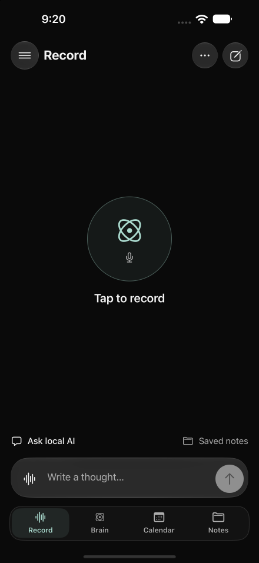
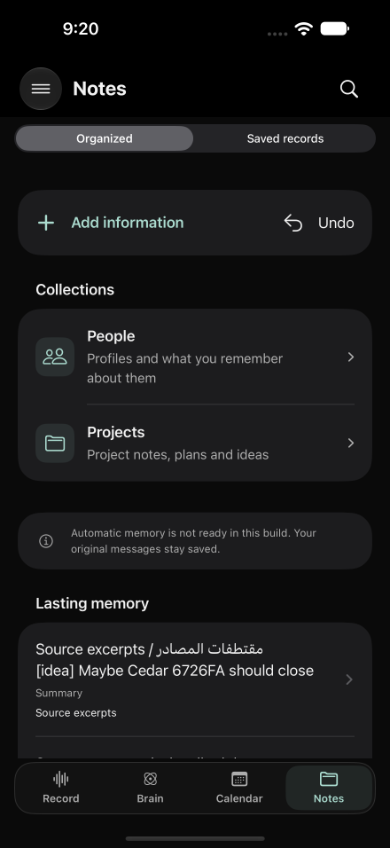

# Eros MemoryOS

Eros MemoryOS is a native iPhone app for keeping personal notes, recordings, and the things you want to remember about people and projects. Save a thought on the Record tab, then reopen it from Notes. The app stores its records on the device.

**Development build.** The SwiftUI workspace runs on an iPhone simulator. The product targets iPhone 15 Pro Max. See the [verification and delivery record](docs/tasks/2026-11-26-native-four-tab-design.md) for the simulator checks and open qualification work.

<p>
  
  
</p>

November 26 captures from the running native app in dark mode on an iPhone 18 Pro Max simulator with iOS 27.2 and fictional data. [Brain graph](docs/evidence/native-four-tab-design-2026-11-26/polish/brain.png) · [Calendar week view](docs/evidence/native-four-tab-design-2026-11-26/polish/calendar.png)

## Save and reopen a thought

1. Open **Record** and tap **Write a thought…**
2. Enter `Bring the Cedar project sketches on Friday.`
3. Tap **Save as memory**, then **OK** when the app confirms the save.
4. Open **Notes → Saved records** and select the thought. The detail shows the text you entered. You can reopen it after quitting and relaunching the app.

## What you can do

- **Record** lets you record or import audio, save a typed thought, or start a local chat. Transcription and chat use models bundled with the build. [Voice and chat details](docs/tasks/2026-11-17-voice-chat.md)
- **Brain** lets you focus on a saved item, follow its direct connections, and search memories. [Workspace details](docs/tasks/2026-11-26-native-four-tab-design.md#implementation)
- **Calendar** shows saved birthdays in month or week view. You must approve a reminder before MemoryOS schedules it. [Birthday and organization details](docs/tasks/2026-11-18-understanding-organization.md)
- **Notes** keeps original records alongside organized information about people and projects. You can correct text while retaining the original, link records, and restore records from Trash. [Storage and backup details](docs/decisions/local-record-storage.md)
- **Settings** lets you switch between English and Arabic and choose the Brain mark used across the app.

Local chat and source retrieval are experimental. Automatic organization from chat stays disabled while quality checks remain open. You can organize records by hand. Cloud sync and third-party AI connections are future work. [Current quality limits](docs/tasks/2026-11-18-understanding-organization.md#november-24-cross-thread-diagnosis-and-safety-repair) · [Implementation checklist](docs/plans/implementation-checklist.md)

## Run on a simulator

Use an Apple silicon Mac with Xcode 27.2, the iOS 27.2 Simulator runtime, and Python 3. The Xcode target sets an iOS 18.0 deployment minimum. Runtime qualification on iOS 18 is still open.

### Prepare the build inputs

The repository keeps model weights and generated native frameworks outside Git. Use the reviewed artifacts for this checkout, or prepare them with the linked instructions. The build verifies them and bundles the models for offline use. The conversation model alone takes about 2.5 GB.

- **Wax.** Prepare the arm64 artifacts in `native/LocalAIIntegrations/RuntimeBinaryIntegration/Artifacts`. [Build instructions](native/LocalAIIntegrations/RuntimeBinaryIntegration/README.md)
- **llama.cpp and Qwen3 4B.** Prepare the llama.cpp XCFramework and obtain the pinned `Qwen3-4B-Q4_K_M.gguf` file. [Runtime instructions](native/LocalTextEvaluation/README.md#reviewed-configuration) · [Model revision and checksum](docs/reference/2026-11-14-local-ai-support.md)
- **Cactus and Qwen3 Embedding 0.6B.** Prepare the XCFramework and its receipt in `native/LocalCactusEvaluation/Artifacts`, along with the verified embedding model directory. [Preparation instructions](native/LocalCactusEvaluation/README.md#reproduce-preparation-and-checks)
- **Whisper.** Prepare the whisper.cpp XCFramework and the multilingual small Q5_1 model. [Preparation instructions](native/LocalTranscription/README.md#reproduce)

If your models live outside the default paths in the project settings, point `MEMORYOS_RELEVANCE_MODEL` to the GGUF file, `MEMORYOS_EMBEDDING_MODEL` to the prepared Cactus model directory, and `MEMORYOS_SPEECH_MODEL` to the Whisper model file. Set these build settings in Xcode or pass them as arguments to `xcodebuild`.

### Build and launch

For a command-line build, run this from the repository root.

```sh
xcodebuild -project native/MemoryOS.xcodeproj -scheme MemoryOS \
  -configuration Release -destination 'generic/platform=iOS Simulator' \
  ARCHS=arm64 CODE_SIGNING_ALLOWED=NO build
```

Open [MemoryOS.xcodeproj](native/MemoryOS.xcodeproj), select the **MemoryOS** scheme and an iPhone simulator, then choose **Product → Run**. The app opens to **Record** with a microphone button and the four-tab dock. Use **Product → Test** to run the scheme's Swift Testing and XCTest targets. [Native setup and testing details](docs/how-to/native-swiftui.md#build-and-run)

## Project records

- [Product overview](docs/product-overview.md), [owner's vision](docs/owner-vision.md), [feature register](docs/feature-register.md), and [decision register](docs/decisions/decision-register.md)
- [Development workflow](docs/how-to/development-workflow.md), [engineering rules](docs/how-to/commercial-engineering-rules.md), and [source and design history](docs/reference/source-register.md)
- [Codebase cleanup](docs/tasks/2026-11-24-codebase-cleanup.md), [local recall integration](docs/tasks/2026-11-18-local-recall-integration.md), and [experimental AI lab](native/LocalAIEvaluation/README.md)
- [Original research](Project_Idea.md), [summary](Project_Idea_Summary.md), and [expanded summary](Project_Idea_Expanded_Summary.md)

Development memory uses a separate [Hindsight project bank](docs/how-to/hindsight.md). The app keeps its own records.

The repository has no top-level source license. See the [bundled third-party notices](native/MemoryOS/Resources/ThirdPartyNotices) and [Whisper license](native/MemoryOS/Resources/Notices/Whisper-LICENSE.txt).
